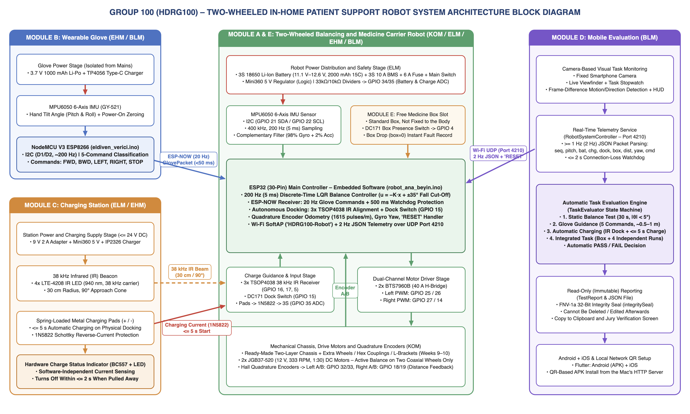
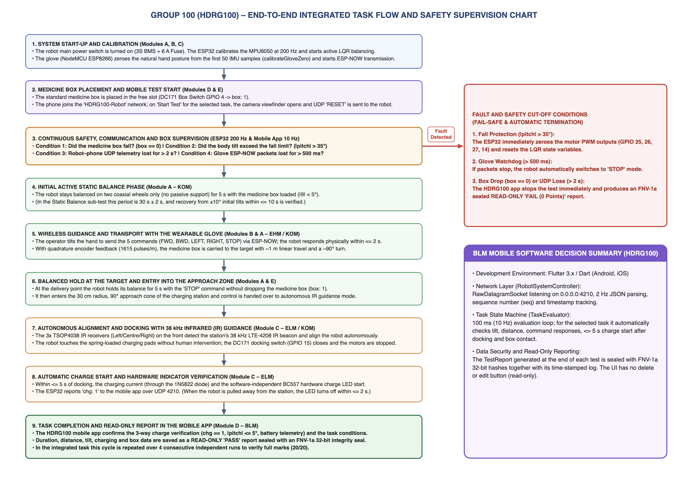

# Two-Wheeled In-Home Patient Support Robot (HDRG100)

[English](#english) | [Türkçe](#türkçe)

Multidisciplinary Design Project (ÇDTP), Yildiz Technical University, Faculty of Electrical and Electronics, Fall 2026–2027. Group 100.

A two-wheeled self-balancing robot that carries a medicine box around the house, takes commands from a wearable glove, docks itself to an IR-guided charging station, and is evaluated by a phone app that watches the run through the camera and writes a tamper-evident test report.



---

## English

### What's in this repo

| Path | Contents |
|---|---|
| `lib/`, `android/`, `ios/`, `test/` | Flutter mobile app (Module D): live telemetry, camera-based motion detection, automatic PASS/FAIL evaluation, sealed reports |
| `esp32_firmware/robot_ana_beyin/` | Robot firmware (ESP32): LQR balance control, glove command handling, IR docking, UDP telemetry |
| `esp32_firmware/eldiven_verici/` | Glove firmware (NodeMCU ESP8266): MPU6050 tilt → 5 commands over ESP-NOW |
| `esp32_firmware/lqr_tasarim/` | Python script that computes the LQR gain matrix from the robot model |
| `esp32_firmware/PIN_BAGLANTI_REHBERI.md` | Wiring guide, pinout and first power-up / tuning procedure (Turkish) |
| `docs/proje-yonetim-plani/` | Project management plan (Turkish and English) |
| `scripts/` | Helpers for installing the app on Android (APK over QR) and iPhone |

### How it fits together

- **Robot (ESP32).** Reads the MPU6050 at 200 Hz, estimates tilt with a complementary filter and balances with a discrete LQR controller, `u = −K·x`, where `x = [tilt, tilt rate, wheel position, wheel velocity]`. Motors are JGB37-520 gearmotors driven by two BTS7960B boards. Above ±35° the motors are cut.
- **Glove (ESP8266).** The hand's resting pose is zeroed at power-up. Tilting forward/back/left/right sends `FWD / BWD / LEFT / RIGHT`, a flat hand sends `STOP`. Packets go out at 20 Hz over ESP-NOW; if the robot hears nothing for 500 ms it stops.
- **Charging station.** A 38 kHz IR beacon (4× LTE-4208) is picked up by three TSOP4038 receivers on the robot. Once the glove is at STOP and the beacon is visible, the robot steers in on its own, presses onto spring contacts, settles, and switches the motors off. The charge LED is driven by the charging circuit (BC557), not by software.
- **Phone app (Flutter).** Joins the robot's `HDRG100-Robot` Wi-Fi and receives 2 Hz JSON telemetry over UDP 4210:

  ```json
  {"seq":12,"pitch":1.4,"bat":85,"chg":1,"dock":1,"box":1,"dist":0.452,"yaw":91.5,"rst":3,"cmd":"FWD"}
  ```

  The camera stream is used for frame-difference motion detection. The app runs the four test tasks from the course specification (static balance, glove guidance, automatic charging, integrated task) and decides PASS/FAIL by itself. Each report carries a time-stamped log and an FNV-1a based seal; if anything in a saved report is edited, the seal check fails.



### Building

**Mobile app** (Flutter 3.x)

```bash
flutter pub get
flutter test
flutter build apk --release          # Android
./scripts/iPhone_Yukle.command        # iPhone, connected to a Mac with Xcode
```

`scripts/QR_Ile_Telefona_Yukle.command` builds the APK and serves it on the local network with a QR code so teammates can install it from their phones.

**Firmware** (Arduino IDE or `arduino-cli`)

| Sketch | Board | Core |
|---|---|---|
| `robot_ana_beyin` | ESP32 Dev Module | esp32 3.x |
| `eldiven_verici` | NodeMCU 1.0 (ESP-12E) | esp8266 3.x |

```bash
arduino-cli compile --fqbn esp32:esp32:esp32 esp32_firmware/robot_ana_beyin
arduino-cli compile --fqbn esp8266:esp8266:nodemcuv2 esp32_firmware/eldiven_verici
```

**LQR gains**

```bash
pip3 install numpy
python3 esp32_firmware/lqr_tasarim/lqr_hesapla.py
```

Update the measured mass and dimensions at the top of the script, run it, and paste the printed `LQR_K` line into `robot_ana_beyin.ino`. The sign checks and balance offset calibration are described step by step in the wiring guide.

### Status

Software for all modules is written and builds. Mechanical assembly and tuning on the real chassis start in week 9; full integration and the four-run rehearsals are planned for weeks 11–14.

### Team

| Name | Department | Main responsibility |
|---|---|---|
| Murat AĞUŞ | Computer Eng. (BLM) | Mobile app, embedded software |
| Muhammed İSMAİL | Computer Eng. (BLM) | Mobile app, embedded software, glove |
| Kaan AKBIYIK | Control and Automation Eng. (KOM) | Balance and motion control |
| Uğur Can GENÇ | Control and Automation Eng. (KOM) | Balance and motion control |
| Doğa KILIÇ | Electrical Eng. (ELM) | Power stage, charging station |
| Ahmad KAZIMOV | Electronics and Communication Eng. (EHM) | Glove electronics, charging station |

Advisor: Asst. Prof. Dr. Bahadır ÇATALBAŞ

---

## Türkçe

### Proje

YTÜ Elektrik-Elektronik Fakültesi Çok Disiplinli Tasarım Projesi (2026–2027 Güz), Grup 100.

Evde bakım gören hastaların ilaç kutusunu ev içinde taşıyan, kendi dengesini iki tekerlek üzerinde aktif olarak sağlayan bir robot. Robot giyilebilir eldivenle yönlendiriliyor, görev sonunda kızılötesi fener yardımıyla şarj istasyonuna kendisi yerleşiyor. Telefon uygulaması görevi kamerayla izliyor, robottan gelen verilerle sonucu otomatik değerlendiriyor ve sonradan değiştirilemeyen bir test raporu üretiyor.

### Klasörler

| Klasör | İçerik |
|---|---|
| `lib/`, `android/`, `ios/`, `test/` | Flutter mobil uygulama (Modül D) |
| `esp32_firmware/robot_ana_beyin/` | Robot yazılımı (ESP32): LQR denge, eldiven komutları, IR ile şarja yerleşme, UDP telemetri |
| `esp32_firmware/eldiven_verici/` | Eldiven yazılımı (NodeMCU ESP8266): el eğimi → ESP-NOW ile 5 komut |
| `esp32_firmware/lqr_tasarim/` | Robot modelinden LQR kazanç matrisini hesaplayan Python betiği |
| `esp32_firmware/PIN_BAGLANTI_REHBERI.md` | Pin bağlantıları, kablolama şeması ve ilk çalıştırma/ayar adımları |
| `docs/proje-yonetim-plani/` | Proje yönetim planı (Türkçe ve İngilizce) |
| `scripts/` | Uygulamayı Android'e (QR ile APK) ve iPhone'a kurma betikleri |

### Sistem kısaca

- **Robot:** MPU6050 200 Hz'de okunuyor, eğim tamamlayıcı filtreyle hesaplanıyor. Denge LQR ile sağlanıyor; durum vektörü eğim, eğim hızı, tekerlek konumu ve tekerlek hızı. Eğim ±35°'yi geçerse motorlar kesiliyor.
- **Eldiven:** Açılışta elin duruşu sıfırlanıyor. El öne, arkaya, sağa, sola eğilince `FWD / BWD / RIGHT / LEFT`, düz tutulunca `STOP` gidiyor. 500 ms paket gelmezse robot duruyor.
- **Şarj istasyonu:** 38 kHz IR fener ve robot üzerindeki üç TSOP4038 ile robot istasyonu buluyor, hizalanıyor, yaylı pedlere dayanıp duruyor. Şarj LED'i yazılımdan bağımsız, doğrudan şarj devresinden sürülüyor.
- **Mobil uygulama:** Robotun `HDRG100-Robot` ağına bağlanıp UDP 4210 üzerinden 2 Hz telemetri alıyor. Kameradan kare farkıyla hareket tespiti yapıyor, şartnamedeki dört görevi (statik denge, eldivenle yönlendirme, otomatik şarj, bütünleşik görev) otomatik değerlendiriyor. Raporlar zaman damgalı kayıtla birlikte mühürleniyor; kayıt elle değiştirilirse mühür doğrulaması bozuluyor.

### Derleme ve kurulum

Mobil uygulama:

```bash
flutter pub get
flutter test
flutter build apk --release
```

- Android: `scripts/QR_Ile_Telefona_Yukle.command` APK'yı derleyip yerel ağda QR koduyla paylaşıyor.
- iPhone: Telefonu Mac'e bağlayıp `scripts/iPhone_Yukle.command` çalıştırmak yeterli.

Firmware Arduino IDE ile yüklenebilir. Robot için kart **ESP32 Dev Module**, eldiven için **NodeMCU 1.0 (ESP-12E)** seçilmeli. Robotu ilk kez çalıştırırken yön işaretlerinin kontrolü, denge noktası ayarı ve LQR kazançlarının hesaplanması [pin bağlantı rehberinde](esp32_firmware/PIN_BAGLANTI_REHBERI.md) adım adım anlatılıyor.

### Durum

Tüm modüllerin yazılımı hazır ve derleniyor. Robotun mekanik montajı ve gerçek şasi üzerindeki ayarlar 9. haftada başlıyor; uçtan uca entegrasyon ve 4 turluk provalar 11–14. haftalarda yapılacak.

### Ekip

Murat AĞUŞ (BLM), Muhammed İSMAİL (BLM), Kaan AKBIYIK (KOM), Uğur Can GENÇ (KOM), Doğa KILIÇ (ELM), Ahmad KAZIMOV (EHM)

Danışman: Dr. Öğr. Üyesi Bahadır ÇATALBAŞ
