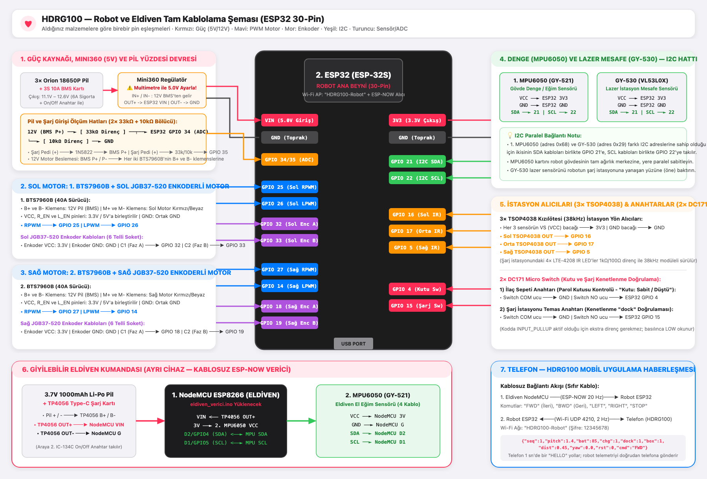

# HDRG100 — ESP32 Donanım ve Pin Bağlantı Rehberi

Sipariş ettiğiniz malzemelere göre **Eldiven (NodeMCU ESP8266)** ve **Robot ESP32 (`ESP-32S 30 Pin`)** bağlantıları aşağıda adım adım listelenmiştir.

---

## 1. Eldiven Devresi (`eldiven_verici.ino` — ESP8266 NodeMCU / ESP-12E)

EHM'ci arkadaşın gönderdiği **`esp.jpeg`** ve **`esp8266-V13.pdf`** dosyalarındaki **ESP8266 NodeMCU (CH340G)** kartına göre birebir pin eşleştirmesi:

| Parça | Pin / Uç | ESP8266 NodeMCU Pini (`esp.jpeg`) | İç GPIO No | Açıklama |
| :--- | :--- | :--- | :--- | :--- |
| **MPU6050 (Eldiven)** | `VCC` | **`3V`** (`3.3V` pini) | - | Sensör beslemesi (3.3V) |
| **MPU6050 (Eldiven)** | `GND` | **`G`** (`GND` pini) | - | Ortak toprak |
| **MPU6050 (Eldiven)** | `SCL` | **`D1`** | `GPIO 5` | I2C Saat hattı (`PIN_SCL = 5`) |
| **MPU6050 (Eldiven)** | `SDA` | **`D2`** | `GPIO 4` | I2C Veri hattı (`PIN_SDA = 4`) |
| **Dahili Mavi LED** | - | **`D4`** | `GPIO 2` | El eğildiğinde (komut giderken) yanar, düzken söner |
| **TP4056 + 3.7V Li-Po** | `OUT+` | **`Vin`** | - | Eldiven batarya girişi |
| **TP4056 + 3.7V Li-Po** | `OUT-` | **`G`** (`GND`) | - | Ortak toprak |

### Eldiven ESP8266 NodeMCU'ya Kodu Yükleme Adımları (`esp8266-V13.pdf` Sayfa 4–7):
1. Arduino IDE -> `File` -> `Preferences` -> `Additional Boards Manager URLs` kısmına şu adresi ekleyin:
   `http://arduino.esp8266.com/stable/package_esp8266com_index.json`
2. `Tools` -> `Board` -> `Boards Manager` içinden **`esp8266 by ESP8266 Community`** paketini kurun.
3. `Tools` -> `Board` menüsünden **`NodeMCU 1.0 (ESP-12E Module)`** (veya PDF'teki gibi **`Generic ESP8266 Module`**) seçin.
4. `CPU Frequency: 80 MHz`, `Upload Speed: 115200` seçip `eldiven_verici.ino` dosyasını yükleyin.
*(Not: Kodun içinde `#if defined(ESP8266)` ve `#elif defined(ESP32)` kontrolü bulunduğu için hem ESP8266 NodeMCU'da hem de ESP32'de sıfır hatayla derlenir.)*

---

## 2. Robot Ana Devresi (`robot_ana_beyin.ino`)

> **⚠️ ÖNEMLİ UYARI (`Mini360` Regülatör):**
> `3× 18650 (12V)` pilden gelen elektriği `Mini360` girişine (`IN+ / IN-`) bağlayın. **ESP32'ye bağlamadan önce** bir multimetre ile `Mini360` çıkışını (`OUT+ / OUT-`) ölçüp üzerindeki küçük vidayı çevirerek **tam `5.0V`** değerine ayarlayın. Ardından `OUT+` ucunu ESP32'nin `VIN` pinine bağlayın.

### A. Denge ve Mesafe Sensörleri (I2C)
| Parça | Pin | Robot ESP32 Pini | Açıklama |
| :--- | :--- | :--- | :--- |
| **1. MPU6050 & GY-530** | `VCC` | `3V3` | 3.3V besleme |
| **1. MPU6050 & GY-530** | `GND` | `GND` | Ortak toprak |
| **1. MPU6050 & GY-530** | `SDA` | `GPIO 21` | I2C Veri (İkisi paralel bağlanır) |
| **1. MPU6050 & GY-530** | `SCL` | `GPIO 22` | I2C Saat (İkisi paralel bağlanır) |

### B. Motor Sürücüler (`2× BTS7960B 40A`)
*(Her iki BTS7960B üzerindeki `R_EN` ve `L_EN` pinlerini `5V`/`3.3V` hattına, `VCC` pinini `3.3V`'a, `B+` ve `B-` klemenslerini ise `6A Sigorta` üzerinden `12V 3S BMS` çıkışına bağlayın.)*

| Parça | Pin | Robot ESP32 Pini | Açıklama |
| :--- | :--- | :--- | :--- |
| **Sol BTS7960B** | `RPWM` | `GPIO 25` | Sol motor ileri PWM |
| **Sol BTS7960B** | `LPWM` | `GPIO 26` | Sol motor geri PWM |
| **Sağ BTS7960B** | `RPWM` | `GPIO 27` | Sağ motor ileri PWM |
| **Sağ BTS7960B** | `LPWM` | `GPIO 14` | Sağ motor geri PWM |

### C. Motor Enkoderleri (`2× JGB37-520 12V 333RPM`)
| Parça | Pin | Robot ESP32 Pini | Açıklama |
| :--- | :--- | :--- | :--- |
| **Sol Motor Enkoder** | `C1 (A)` / `C2 (B)` | `GPIO 32` / `GPIO 33` | Mesafe sayacı (Sol) |
| **Sağ Motor Enkoder** | `C1 (A)` / `C2 (B)` | `GPIO 18` / `GPIO 19` | Mesafe sayacı (Sağ) |

### D. Şarj İstasyonu Alıcıları (`3× TSOP4038`) ve Micro Switch'ler (`2× DC171`)
| Parça | Pin | Robot ESP32 Pini | Açıklama |
| :--- | :--- | :--- | :--- |
| **Sol TSOP4038** | `OUT` | `GPIO 16` | Sol IR istasyon alıcısı |
| **Orta TSOP4038** | `OUT` | `GPIO 17` | Orta IR istasyon alıcısı |
| **Sağ TSOP4038** | `OUT` | `GPIO 5` | Sağ IR istasyon alıcısı |
| **1. DC171 Micro Switch** | `NO` ve `COM` | `GPIO 4` ve `GND` | Yuvada **ilaç kutusu** var mı? (`box`) |
| **2. DC171 Micro Switch** | `NO` ve `COM` | `GPIO 15` ve `GND` | Robot istasyona kenetlendi mi? (`dock`) |

### E. Pil Gerilimi ve Şarj Girişi Ölçümü (`2× 33kΩ + 10kΩ` bölücü)
* **Pil:** `12V (3S BMS P+)` ──► **`33kΩ`** ──┬──► **`GPIO 34`** · `┴──► 10kΩ ──► GND`
* **Şarj girişi:** `Şarj pedi (+)` ──► **`33kΩ`** ──┬──► **`GPIO 35`** · `┴──► 10kΩ ──► GND`
  (Bölücü, pedin **1N5822 diyotundan ÖNCEKİ** ucuna bağlanır. Robot istasyona oturup pedde gerilim
  görününce telemetride `chg: 1` olur; böylece "şarj başladı" bilgisi gerçek şarj geriliminden ölçülür.)
* Her iki bölücü 12,6 V'u ~2,93 V'a düşürür; ESP32 ADC'sine güvenle bağlanır.

---

## 3. Telefon ile Bağlantı
1. Robotun şalterini açınca ESP32 **`HDRG100-Robot`** (şifre: `12345678`) Wi-Fi ağını kurar.
2. Telefonu bu ağa bağlayıp **HDRG100** uygulamasını açın. Uygulama saniyede bir `HELLO` gönderir;
   robot telefonun adresini öğrenip telemetriyi (2 Hz) doğrudan telefona yollar:
   `{"seq","pitch","bat","chg","dock","box","dist","yaw","rst","cmd"}`
3. **Kurulum:** Android için `scripts/QR_Ile_Telefona_Yukle.command` APK'yı QR ile dağıtır.
   iPhone için telefonu Mac'e kabloyla bağlayıp `scripts/iPhone_Yukle.command` çalıştırılır.
   (Web/PWA sürümü robotla haberleşemez: tarayıcılar UDP ve bu adreste kamera izni vermez.)

---

## 4. Robotu İlk Kez Çalıştırma ve Ayar (8.–9. hafta)
Derlemeden önce Arduino IDE > Kütüphane Yöneticisi'nden **`VL53L0X` (Pololu)** kütüphanesini kurun.
Seri monitörü **115200** baud açın. `d` tuşu tanı çıktısını açar/kapatır.

1. **IMU kalibrasyonu:** Açılışta robotu ~1 sn hareketsiz tutun (gyro sıfır kayması ölçülür).
   Robot açıldığında motorlar kapalıdır; elle dik tutulunca (|eğim| < 5°, 0,5 sn) denge başlar.
2. **İşaret kontrolleri** (`robot_ana_beyin.ino` başındaki `*_SIGN` sabitleri):
   * Robotu **öne** eğin → `pitch` **artmalı**; öne eğerken `rate` de **artı** olmalı.
   * Robotu elle **ileri** itin → `x` **artmalı** (sol/sağ enkoder işaretleri).
   * Robot yerdeyken (devrik, `mod:FALLEN`) `l` / `r` tuşları sol/sağ motoru 0,5 sn döndürür;
     tekerlek **ileri** yönde dönmeli (değilse `LEFT/RIGHT_MOTOR_SIGN`).
   * Robotu yukarıdan bakınca **sağa** döndürün → `yaw` **artmalı**.
3. **Denge noktası:** Robotu dengede elle tutup `pitch` değerini okuyun ve `balanceOffsetDeg` olarak yazın.
4. **LQR kazançları:** Şasiyi tartıp ağırlık merkezi yüksekliğini ölçün, `lqr_tasarim/lqr_hesapla.py`
   içindeki değerleri güncelleyip çalıştırın; çıkan `LQR_K` satırını koda yapıştırın.
   Salınım varsa `teta_max`'ı küçültün, robot kayıyorsa `konum_max`'ı küçültün.
5. **Şarj istasyonu:** Şartname gereği robot istasyona oturup stabil olunca motorlar durur
   (`DOCK_SETTLE_MS`). Bu yüzden istasyonda robotun **yaslanacağı bir dayanak** olmalı ve yaslanınca
   eğim **±10°'yi** geçmemeli (uygulama şarj doğrulamasında |eğim| ≤ 10° arar).
6. **Yaklaşma hızı (GY-530):** Tanı çıktısındaki `tof` değeri istasyona yaklaştıkça azalmalı.
   Robot 250 mm'den itibaren yavaşlar, 60 mm'de en düşük hıza iner (`TOF_SLOWDOWN_*`).
   Sensör takılı değilse açılışta "vl53l0x bulunamadi" yazar ve yaklaşma sabit hızla yapılır.
7. **Şarj algılama:** Robot istasyondayken tanı çıktısındaki `sarjGiris` gerilimi 9 V'un üstünde
   olmalı (`CHARGE_DETECT_VOLT`).
